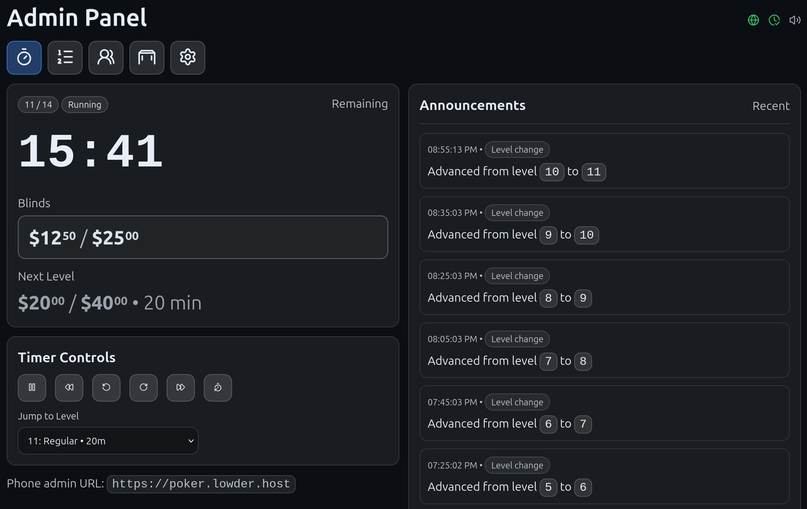
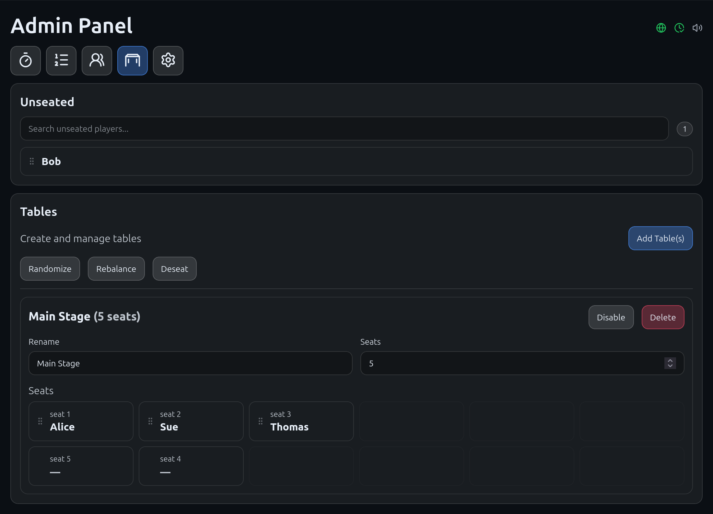
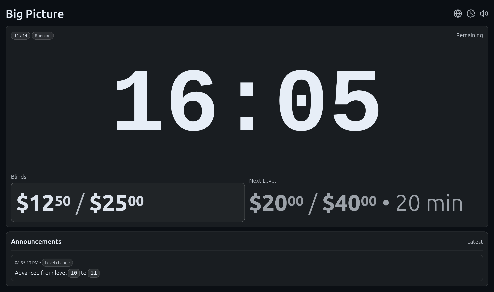

# Super Poker Timer

A LAN-friendly web app for running a freezeout-style poker tournament. It includes a server-authoritative level timer, basic player tracking, and table seating tools.

## Features

- Level timer with a configurable schedule (regular + break levels) and blinds/ante per level
- Real-time updates to all clients (admin and display) over WebSocket
- Admin UI (start/pause, jump levels, add time, manage players/tables/seats)
- Display mode for a TV/projector at `/display` (read-only, still plays configured sounds)
- Optional sound cues: level transition, halfway, 30 seconds, 5 seconds, end
- Seating tools: manual seat moves, randomize seating, rebalance tables, deseat everyone
- Chip planner: works out how many chips of each colour every player gets, and when to colour up
- Announcements for seating operations and timer events (shown in admin and display mode)

## Screenshots

### Admin panel — timer

Timer controls, current/next blinds, jump to level, and a running feed of announcements.



### Admin panel — tables and seating

Drag players between the unseated list and table seats, or use randomize / rebalance / deseat.



### Display mode — big picture

Read-only view for a TV or projector at `/display`.



## Quick start (Docker)

```bash
docker compose up --build
```

Open:

- Admin UI: http://localhost:5173
- Display mode: http://localhost:5173/display
- Backend API: http://localhost:8000/docs

On your phone, replace `localhost` with the IP of the machine running Docker (for example `http://192.168.1.50:5173`).

## Persistence

- SQLite DB: docker volume `pokertourney_data`
- Sounds: put files into `./sounds` (mounted into backend)

## Adding sounds

Put audio files into `./sounds` (mp3/wav/ogg/m4a). They appear in the Sounds dropdowns.
The backend serves them at `/sounds/<filename>`.

## Announcements

Seating operations (randomize, rebalance, deseat) and timer events (level changes/resets, schedule complete) create announcements.
Display mode shows announcements prominently.

## Seating settings

Minimum players per table (default 4): randomize/rebalance will reduce the number of tables when possible to keep at least this many players per used table.

## Chip denominations

The Chips tab plans a chip distribution from your buy-in structure and the chips you actually own.

Pick from ten standard chip colours, set what each is worth and how many you have, then give it a
starting stack, a rebuy stack, and a maximum number of rebuys per player. Player count defaults to
the tourney roster and can be overridden. Everything is sized for the worst case -- every player
using all of their rebuys -- so your chips are guaranteed to cover the night.

The planner aims for stacks that are easy to play with a real table of people:

- Every stack is worth the buy-in exactly, shown both per player and as the pile to count
  out of the box for all buy-ins and all rebuys
- Small blinds and big blinds can always be posted without making change, and players hold enough
  small chips to keep posting them
- Chip counts come out in round numbers (five 10c chips rather than seven)
- Chips finer than the blinds require are left out entirely
- Your inventory is a hard cap; you get a warning when supply forces a worse mix, and an error when
  the tourney simply needs more chips than you own

With colour ups enabled it also produces a per-break schedule for retiring the smallest chip,
always at a whole exchange ratio, and only once the blinds have outgrown it. A colour up can trade
into a chip that never appeared in the starting stack -- a denomination too large to deal at the
start is still available later -- and each step estimates the reserve of the larger chip it needs.

## Local development (no Docker)

Backend (FastAPI):

```bash
cd backend
python3 -m venv .venv
source .venv/bin/activate
pip install -r requirements.txt
uvicorn app.main:app --reload --host 0.0.0.0 --port 8000
```

Frontend (Vite + React):

```bash
cd frontend
npm install
VITE_BACKEND_URL=http://localhost:8000 npm run dev -- --host 0.0.0.0 --port 5173
```

## Running tests

Backend unit tests (pytest):

```bash
cd backend
python3 -m venv .venv
source .venv/bin/activate
pip install -r requirements.txt -r requirements-test.txt
pytest
```

CI runs the same suite via GitHub Actions: `.github/workflows/tests.yaml`.

## Configuration

Backend environment variables:

- `DATABASE_PATH` (default `./app.db`)
- `SOUNDS_DIR` (default `./sounds`)
- `CORS_ALLOW_ORIGINS` (default `*`)

Frontend environment variables:

- `VITE_BACKEND_URL` (default `http://backend:8000`)
- `VITE_ALLOWED_HOSTS` (default `all`)

Settings JSON:

- `settings.seating.min_players_per_table` (default `4`)
- `settings.chips` — chip colours, values, quantities and buy-in structure for the Chips tab

## Notes

- This is intended for a trusted LAN. There is no authentication.
